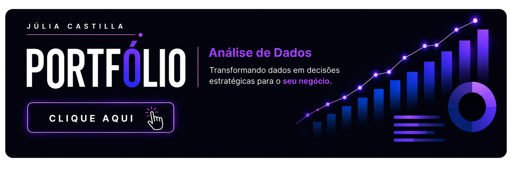

## Olá

## Sobre mim

**Profissional de Dados**, com formação profissional em **Análise de Dados pela EBAC** e graduação em **Marketing Digital pela Universidade Estácio de Sá**, com trajetória profissional orientada à **análise de métricas, indicadores e performance**.

Atualmente, atuo como **Analista de Dados voluntária no Projeto Nossa Entrega**, desenvolvendo análises de dados relacionadas à **participação de voluntários e à logística de ações sociais**.

Também desenvolvo projetos utilizando **SQL, Python, Power BI, Google BigQuery e pandas**, aplicando técnicas de **exploração, tratamento e validação de dados, construção de dashboards e identificação de oportunidades de melhoria**.

Minha experiência anterior em **Marketing Digital** complementa meu perfil analítico com **visão de negócio** e experiência em análise de **KPIs, performance, comportamento e identificação de oportunidades**.

Busco atuar como **Analista de Dados**, transformando dados em **análises e recomendações que apoiem a tomada de decisão**.

## Tecnologias e Ferramentas

**Análise e Programação:** Python • SQL • pandas • NumPy • EDA • Estatística Descritiva • Estatística Aplicada  
**Business Intelligence e Visualização:** Power BI • DAX • Power Query • Looker Studio • Matplotlib • Seaborn • Plotly • Dash • Streamlit  
**Bancos e Engenharia de Dados:** Google BigQuery • MySQL • Modelagem de Dados • ETL • Limpeza e Validação de Dados  
**Machine Learning:** Regressão Logística • Random Forest  
**Ferramentas de Dados e Desenvolvimento:** Excel • Google Sheets • Google Analytics (GA4) • Google Search Console • Git • GitHub • Linux • Jupyter Notebook • Google Colab • Visual Studio Code

## Meu Portfólio

Projetos de **Análise de Dados** desenvolvidos em diferentes contextos de negócio, envolvendo **exploração, tratamento e validação de dados, SQL, programação, Business Intelligence, Machine Learning e visualização**, com foco na transformação de dados em **análises que apoiem a tomada de decisão**.

 

 

## Contatos

  

  

